# Secure Two-Tier Web Application on Azure

## 🎬 Watch the walkthrough

[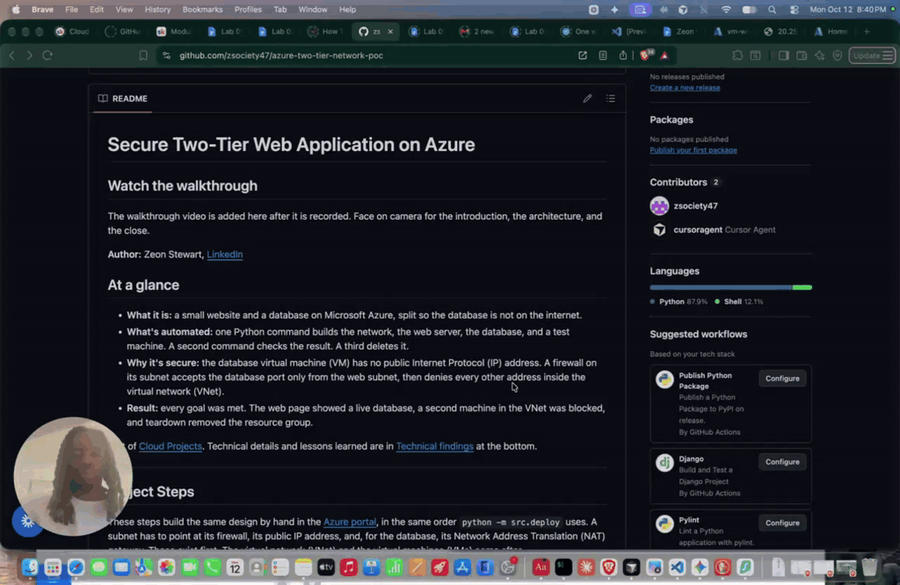](https://www.loom.com/share/3627b9267eff4235b9f635ca752d191c)

Face on camera for the introduction, the architecture, and the close. Click the thumbnail to play.

**Author:** Zeon Stewart, [LinkedIn](LINKEDIN_LINK_HERE)

## At a glance

- **What it is:** a small website and a database on Microsoft Azure, split so the database is not on the internet.
- **What's automated:** one Python command builds the network, the web server, the database, and a test machine. A second command checks the result. A third deletes it.
- **Why it's secure:** the database virtual machine (VM) has no public Internet Protocol (IP) address. A firewall on its subnet accepts the database port only from the web subnet, then denies every other address inside the virtual network (VNet).
- **Result:** every goal was met. The web page showed a live database, a second machine in the VNet was blocked, and teardown removed the resource group.

Part of [Cloud Projects](https://github.com/zsociety47/cloud-projects). Technical details and lessons learned are in [Technical findings](#technical-findings) at the bottom.

---

## Project Steps

These steps build the same design by hand in the [Azure portal](https://portal.azure.com), in the same order `python -m src.deploy` uses. A subnet has to point at its firewall, its public IP address, and, for the database, its Network Address Translation (NAT) gateway. Those exist first. The virtual network (VNet) and the virtual machines (VMs) come after.

Use East US for every resource. On each resource, add the tags `project = azure-two-tier-network-poc`, `environment = poc`, `managed-by = portal`, and `owner = <your name>`. The Python deploy uses `managed-by = python-sdk` and `owner = zeon` so a hand-built group and a script-built group are easy to tell apart.

Portal labels move from time to time. If a button has moved, search for the setting name in the portal's top search bar. Each step below has a screenshot of what the portal should show when that step is done.

### Before the portal: create the Secure Shell key

*Automated by `src/lib/sshkey.py` on the first `python -m src.deploy`.*

Secure Shell (SSH) is port 22. The VMs accept an SSH public key and refuse password login. Create the key on your own machine before any Azure resource exists. The private key stays in `keys/`, which is gitignored. Only the public half is pasted into the portal.

```bash
mkdir -p keys
ssh-keygen -t ed25519 -f keys/id_ed25519 -N ""
```

Find your current public Internet Protocol (IP) address. Open `https://api.ipify.org` in a browser. The page shows one address. You will use `<that address>/32` as the only source allowed to SSH to the web VM. Do not commit that address.

### Step 1: Create a resource group

*Automated by `python -m src.deploy`.*

1. Search for **Resource groups** and select **+ Create**.
2. **Subscription:** the subscription you want to use.
3. **Resource group:** `rg-twotier-poc-zeon01`
4. **Region:** East US.
5. **Tags** tab: the four tags above.
6. Select **Review + create**, then **Create**.

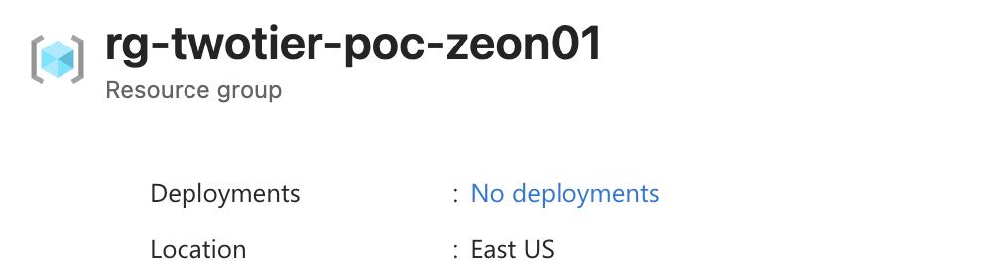

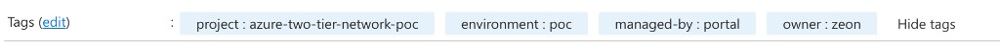

### Step 2: Create the two public IP addresses

*Automated by `python -m src.deploy`.*

The web VM and the NAT gateway each need a public IP address that already exists. Create both before either consumer.

1. Search for **Public IP addresses** and select **+ Create**.
2. **Name:** `pip-web-01`. **Resource group:** `rg-twotier-poc-zeon01`. **Region:** East US.
3. **SKU:** Standard. SKU is the stock-keeping unit, the pricing tier. **Assignment:** Static. **IP version:** IPv4.
4. Create it, then create a second public IP with the same settings named `pip-nat-01`.

`pip-web-01` will sit on the web VM. `pip-nat-01` will sit on the NAT gateway. Neither address is attached to the database VM.

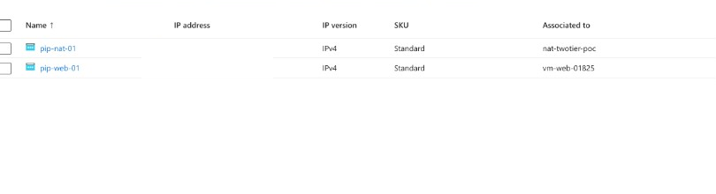

### Step 3: Create the NAT gateway

*Automated by `python -m src.deploy`.*

New VNets use private subnets, so a VM with no public IP cannot download packages unless you add an explicit outbound path. The database subnet gets that path here. The gateway is created now, and attached to `snet-db` in step 7, because the subnet does not exist yet.

1. Search for **NAT gateways** and select **+ Create**.
2. **Name:** `nat-twotier-poc`. **Region:** East US. **SKU:** Standard. The form often opens on StandardV2. Change it to Standard. A StandardV2 gateway cannot use `pip-nat-01`, because that address is Standard.
3. **TCP idle timeout:** 4 minutes. TCP is the Transmission Control Protocol.
4. **Public IP:** select the existing `pip-nat-01`. Do not create a new one.
5. Leave the subnet blank for now. Select **Review + create**, then **Create**.

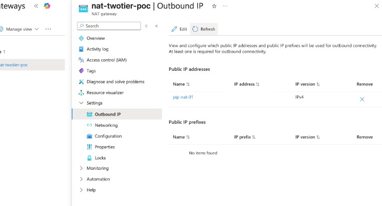

### Step 4: Firewall the web subnet

*Automated by `python -m src.deploy`.*

A network security group (NSG) is the subnet firewall. Create it now. Attach it to `snet-web` in step 7, when that subnet is created. Do not also put a firewall on the VM's network interface. Two firewalls are easy to set and then forget.

1. Search for **Network security groups** and select **+ Create**.
2. **Name:** `nsg-web`. **Resource group:** `rg-twotier-poc-zeon01`. **Region:** East US.
3. After it is created, open **Inbound security rules** and add:

| Name | Priority | Source | Destination port | Protocol | Action |
|---|---|---|---|---|---|
| Allow-Http-Internet | 100 | Any | 80 | TCP | Allow |
| Allow-Ssh-Operator | 110 | Your current public IP address, as a `/32` | 22 | TCP | Allow |

Hypertext Transfer Protocol (HTTP) is port 80. Limiting SSH to your current public address means the rest of the internet cannot log in to the web VM.

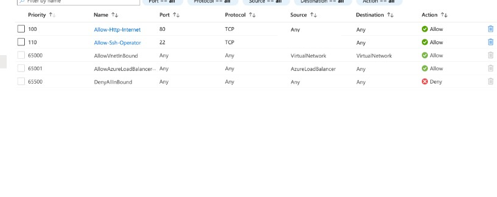

### Step 5: Firewall the database subnet

*Automated by `python -m src.deploy`.*

This is the rule that makes the proof true. Azure already has a built-in inbound rule, AllowVnetInBound, at priority 65000. A lower number wins, and that built-in rule allows every address in the VNet. An allow rule for the web subnet does not, by itself, stop anyone else in the VNet. The deny rule at priority 200 has to sit above that default.

1. Create an NSG named `nsg-db` in the same resource group and region.
2. Add these inbound rules:

| Name | Priority | Source | Destination port | Protocol | Action |
|---|---|---|---|---|---|
| Allow-Postgres-From-Web | 100 | `10.0.1.0/24` | 5432 | TCP | Allow |
| Allow-Ssh-From-Web | 110 | `10.0.1.0/24` | 22 | TCP | Allow |
| Allow-Icmp-From-Web | 120 | `10.0.1.0/24` | Any | Internet Control Message Protocol (ICMP) | Allow |
| Deny-Other-Vnet | 200 | Service tag **VirtualNetwork** | Any | Any | Deny |

Port 5432 is PostgreSQL. ICMP is what `ping` uses. The real proof is the TCP check on 5432, from the web VM and from the test VM. Do not associate the NSG yet.

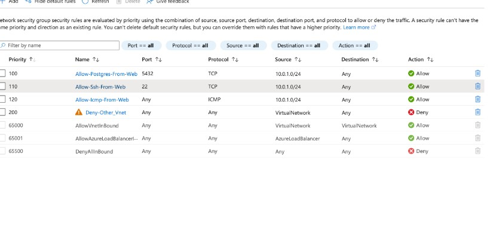

### Step 6: Firewall the test subnet

*Automated by `python -m src.deploy`.*

1. Create an NSG named `nsg-test`.
2. Add one inbound rule: name `Allow-Ssh-From-Web`, priority 100, source `10.0.1.0/24`, destination port 22, protocol TCP, action Allow.

The test VM exists so a machine that is inside the VNet, and outside the web subnet, can try port 5432 and be blocked. It has no rule of its own for 5432. The database NSG is what blocks it.

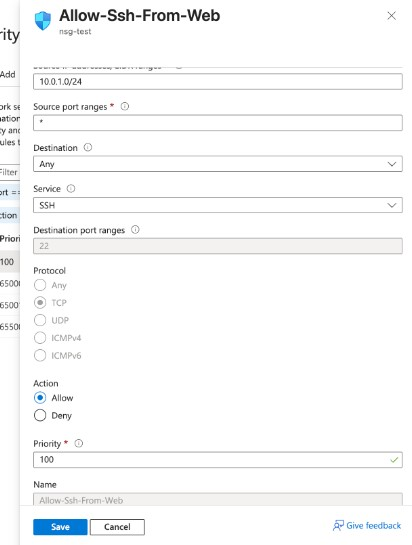

### Step 7: Create the virtual network and three subnets

*Automated by `python -m src.deploy`.*

1. Search for **Virtual networks** and select **+ Create**.
2. **Resource group:** `rg-twotier-poc-zeon01`. **Name:** `vnet-twotier-poc`. **Region:** East US.
3. **IP addresses:** address space `10.0.0.0/16`. Delete the portal's default subnet and add these three. On each one, turn **default outbound access** off. The portal may call that a private subnet.

| Subnet | Address | NSG | NAT gateway |
|---|---|---|---|
| `snet-web` | `10.0.1.0/24` | `nsg-web` | None |
| `snet-db` | `10.0.2.0/24` | `nsg-db` | `nat-twotier-poc` |
| `snet-test` | `10.0.3.0/24` | `nsg-test` | None |

4. Select **Review + create**, then **Create**.

The web VM gets out through `pip-web-01`. The database subnet gets out through `nat-twotier-poc`. The test subnet does not need the internet.

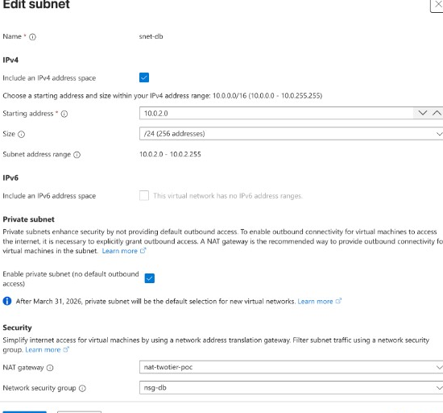

### Step 8: Create the web VM

*Automated by `python -m src.deploy`.*

Every VM in this project uses the same machine settings. The networking is what changes.

- **Image:** Ubuntu Server 24.04 Long Term Support (LTS)
- **Size:** Standard_F1als_v7 (1 vCPU, 2 GB of memory). Standard_B1s was the first choice. This subscription cannot create that size in East US.
- **Username:** `azureuser`
- **Authentication:** SSH public key. Paste `keys/id_ed25519.pub`. Password authentication stays off.
- **OS disk:** 30 GB, Standard SSD, locally redundant storage (Standard SSD LRS). SSD is a solid-state drive. Delete the disk when the VM is deleted.
- **Public inbound ports:** None. The subnet NSG is the firewall. Choosing ports here would add a second NSG on the network interface.
- **Network interface delete option:** delete the network interface (NIC) when the VM is deleted.

1. Search for **Virtual machines** and select **+ Create** > **Azure virtual machine**.
2. **Resource group:** `rg-twotier-poc-zeon01`. **Name:** `vm-web-01`. **Region:** East US. Apply the shared settings above.
3. **Networking:** virtual network `vnet-twotier-poc`, subnet `snet-web`. **Public IP:** select the existing `pip-web-01`. Do not click **Create new**. **NIC network security group:** None. Check **Delete NIC when VM is deleted**. Leave **Delete public IP when VM is deleted** unchecked. This size requires accelerated networking, so leave that box as the portal sets it. **Load balancing:** None.
4. Select **Review + create**, then **Create**.
5. The portal names the network interface for you and gives it a dynamic private address. This form has no field for `nic-web-01` or `10.0.1.4`. A network interface cannot be renamed later. `python -m src.deploy` still creates `nic-web-01` with that address. After the VM exists, open it, select **Network settings**, select the network interface, then **IP configurations**, then `ipconfig1`. Set the assignment to Static and the address to `10.0.1.4`, then save. The VM restarts.

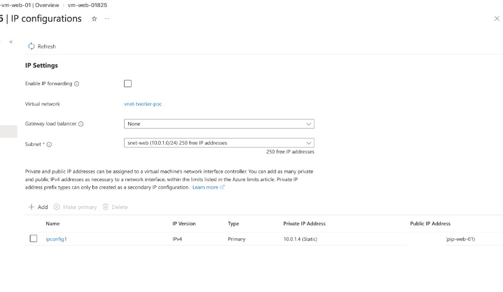

### Step 9: Create the database VM

*Automated by `python -m src.deploy`.*

1. Create `vm-db-01` with the same image, size, disk, username, and SSH public key.
2. **Public inbound ports:** None. **Public IP:** None.
3. **Networking:** subnet `snet-db`. **Public IP:** None. **NIC network security group:** None. After the VM exists, set the private address to Static `10.0.2.4` the same way as step 8. The web page connects to that address. The portal names the network interface. `python -m src.deploy` names it `nic-db-01`.

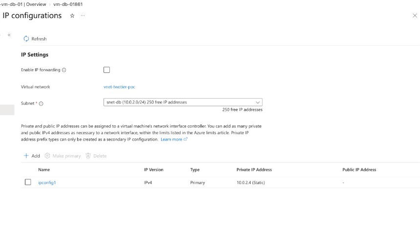

### Step 10: Create the test VM

*Automated by `python -m src.deploy`.*

1. Create `vm-test-01` the same way, on subnet `snet-test`, with no public IP.
2. After the VM exists, set the private address to Static `10.0.3.4`. The portal names the network interface. `python -m src.deploy` names it `nic-test-01`.

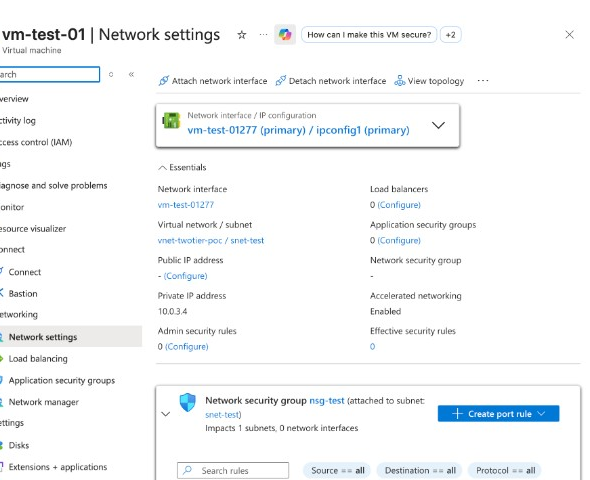

### Step 11: Install PostgreSQL, then the web page

*Automated by `python -m src.deploy`, which sends `src/guest/db-setup.sh` and then `src/guest/web-setup.sh` with Azure VM Run Command.*

The database is installed first. The page has nothing to connect to until PostgreSQL is listening.

By hand, open the VM and use **Run command** > **RunShellScript**. Do not put the script in the VM's custom data. Custom data is visible later in the portal.

1. Pick a database password in your own session. In a copy of `src/guest/db-setup.sh`, replace `__DB_PASSWORD__` with that password. Paste the copy into Run command on `vm-db-01`. Do not save the filled-in script, and do not commit it.
2. The script is finished when the output includes `DB_READY`. PostgreSQL listens on `10.0.2.4` only. It allows the web subnet `10.0.1.0/24` with a SCRAM-SHA-256 password. SCRAM-SHA-256 is the password handshake. The database role is `webapp`. The database name is `appdb`.
3. Replace the same placeholder in a copy of `src/guest/web-setup.sh` and run that copy on `vm-web-01`. Wait until the output includes `WEB_READY`.
4. Leave `vm-test-01` as it is. It only needs the TCP check in the next step.

The web page is nginx on port 80, forwarding to a small Python app on `127.0.0.1` port 8080. The app reads the password from `/etc/twotier/db.env`, connects to PostgreSQL at `10.0.2.4` port 5432, and prints `database-connected` plus the database version.

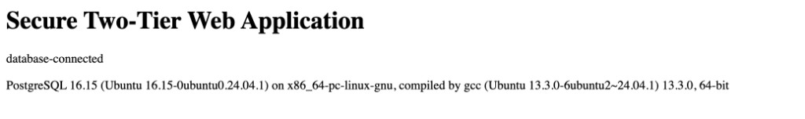

### Step 12: Prove what is allowed and what is blocked

*Automated by `python -m src.verify`.*

1. On `vm-web-01`, open **Overview** and copy the public IP address on `pip-web-01`. Open `http://<that address>/` in your browser. The page should return HTTP 200 and include the text `database-connected`.
2. Open `nic-db-01`. Confirm it has no public IP address.
3. On `vm-web-01`, open **Run command** > **RunShellScript** and run:

```bash
timeout 8 bash -c 'echo >/dev/tcp/10.0.2.4/5432'; echo $?
```

`0` means the port opened. That is the pass for the web VM.

4. Run the same command on `vm-test-01`. `124` means it timed out. A timeout is the pass for the test VM: the firewall dropped the packet. A fast refusal would mean the packet reached PostgreSQL.
5. SSH to the database goes through the web VM. The private key stays on your machine:

```bash
ssh -i keys/id_ed25519 -J azureuser@<web public IP> azureuser@10.0.2.4
```

`-J` is ProxyJump. Your machine connects to the web VM first, then from there to `10.0.2.4`. The same pattern reaches the test VM at `10.0.3.4`. Do not copy `keys/id_ed25519` onto the web VM.

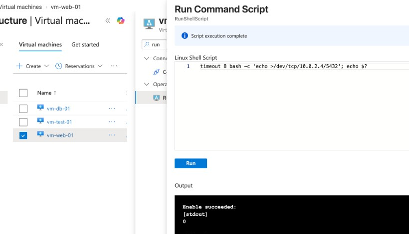

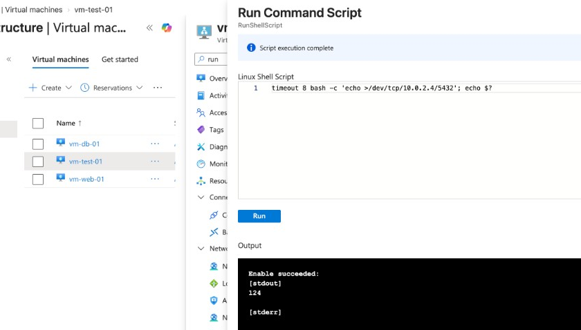

### Step 13: Clean up when you're done

*Automated by `python -m src.teardown`, which asks you to type the resource group name before it deletes anything.*

1. Open resource group `rg-twotier-poc-zeon01` and select **Delete resource group**.
2. Type the resource group name to confirm. That delete removes the VMs, the NICs, the disks, both public IP addresses, the NAT gateway, the NSGs, and the VNet.
3. Confirm the resource group no longer appears in the list.

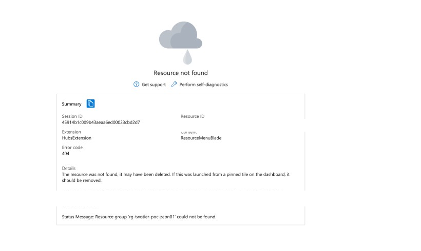

---

## Automated setup

You need Python 3.11 or newer, an Azure subscription, and a current `az login` so the scripts can sign in. They use `DefaultAzureCredential` from the Azure software development kit (SDK). No password is stored in the repository.

From the repository root:

```bash
python3 -m venv .venv
source .venv/bin/activate
pip install -r requirements.txt
python -m src.deploy --plan
python -m src.deploy
python -m src.verify
```

`--plan` prints the resource names and exits. It does not call Azure.

`python -m src.deploy` replaces the SSH key and steps 1 through 11. It is safe to run again: existing resources are updated, and an existing VM is left in place. The database password is generated in memory for that run, sent to the two VMs, and never printed.

<!--  -->

`python -m src.verify` replaces step 12 and prints a pass/fail table. Check 6 stays "not run" until you delete the group.

<!--  -->

When you are finished:

```bash
python -m src.teardown
python -m src.verify --after-teardown
```

Teardown asks you to type `rg-twotier-poc-zeon01` before it deletes anything.

<!--  -->

The first time deploy runs, it writes an SSH key to `keys/id_ed25519`. That folder is gitignored. Later runs reuse the same key.

Sign in with the Azure command-line interface (CLI) in a browser before the Python commands:

```bash
az login
```

Deploy reads that session. It does not read a password from this repository. If Microsoft Entra ID asks for multi-factor authentication (MFA), approve the prompt in the browser. Do not add `--use-device-code`. That flow is often blocked when the computer is not registered with Entra ID. The page then says the sign-in succeeded and the device is unregistered. A browser `az login` is the path this project uses.

Someone who clones the repository signs in to their own tenant. They are not affected by this tenant's device policy. They do get an MFA prompt when their own tenant requires one. Their subscription may also allow a smaller virtual machine size. This subscription cannot, so the size in the code stays `Standard_F1als_v7`.

### Prove it in the portal

After `python -m src.deploy` prints a web address, these pages are the same checks the verify command runs. Search for the resource name in the portal.

| Check | Where to click | A pass looks like |
|---|---|---|
| 1. The page reaches the database | The address deploy printed, in a browser | The body contains `database-connected` and a PostgreSQL version |
| 2. The database is not on the internet | `nic-db-01` → **IP configurations** | Public IP is empty. Private IP is `10.0.2.4` |
| 3. The web tier can open port 5432 | `vm-web-01` → **Run command** → **RunShellScript** | `timeout 8 bash -c 'echo >/dev/tcp/10.0.2.4/5432'; echo $?` prints `0` |
| 4. A machine outside the web subnet cannot | `vm-test-01` → the same Run command | The same command prints `124`. That timeout means the firewall dropped the packet |
| 5. Database SSH is only from the web subnet | `nsg-db` → **Inbound security rules** | Port 5432 and port 22 allow `10.0.1.0/24`. Priority 200 denies **VirtualNetwork**. `nic-db-01` still has no public IP |
| 6. Teardown removed the group | **Resource groups** | `rg-twotier-poc-zeon01` is not in the list |

### Prove it from the command line

`python -m src.verify` runs checks 1 through 5 and prints a pass/fail table. Check 6 stays "not run" because the group still exists. The command also prints the web address it requested.

A passing table is:

| # | Result |
|---|---|
| 1 | Web page loads and shows the database: PASS |
| 2 | Database VM has no public IP: PASS |
| 3 | Web VM reaches database port 5432: PASS |
| 4 | Test VM is blocked on port 5432: PASS |
| 5 | Database SSH only from the web subnet: PASS |
| 6 | Teardown leaves nothing behind: NOT RUN |

Check 4 passes only on `timeout`. `open` means the block failed. `refused` means the packet reached PostgreSQL.

After teardown:

```bash
python -m src.verify --after-teardown
```

That run checks only row 6. PASS means the resource group is gone.

---

## Architecture

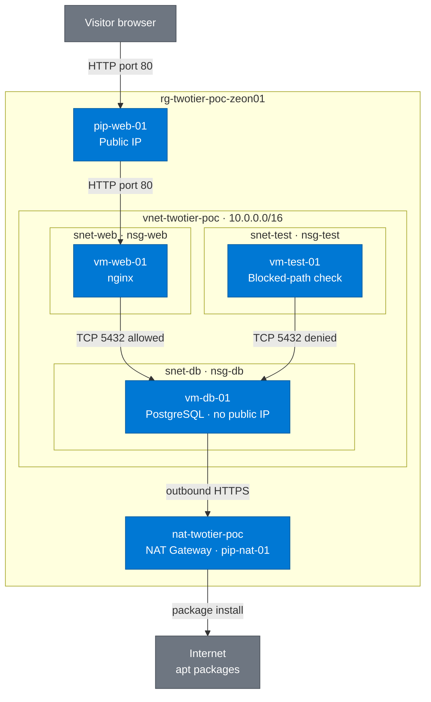

**How to read this diagram**

- **Solid arrows:** live traffic. HTTP lands on `pip-web-01`, which sits outside the virtual network, then on the web VM. PostgreSQL allows the web subnet and denies the test VM. The database VM has no public IP, so outbound package installs go through the NAT gateway and `pip-nat-01`.
- **Blue:** Azure resources. **Gray:** the browser and the internet.
- Python deploy creates these resources. It is not drawn as an arrow, so those lines do not wrap around the boxes.

*Visitors reach nginx on the web VM. The database accepts PostgreSQL only from the web subnet. The NAT public IP is not attached to the database VM.*

*Diagram follows the [shared diagram standard](https://github.com/zsociety47/cloud-projects/blob/main/standards/DIAGRAM-STANDARD.md).*

---

## Hypothesis

A database VM with no public IP, in a private subnet, is reachable on the database port only from the web tier. Other addresses in the same VNet are blocked.

## Success criteria

| # | Criterion | How it is checked | Result |
|---|-----------|-------------------|--------|
| 1 | The web page loads from the internet on port 80 and shows a live database result | `python -m src.verify` requests the public address | ✅ |
| 2 | `vm-db-01` has no public IP | The verify command reads the database network interface | ✅ |
| 3 | The web VM reaches TCP port 5432 on `10.0.2.4` | Run command on `vm-web-01` | ✅ |
| 4 | A VM outside the web subnet is blocked on port 5432 | Run command on `vm-test-01` | ✅ |
| 5 | SSH to the database works only from the web subnet | NSG rules, plus no public IP on the database VM. By hand: `ssh -J` | ✅ |
| 6 | Teardown leaves nothing behind | `python -m src.teardown`, then `python -m src.verify --after-teardown` | ✅ |

## What's in this repository

```
.
├── requirements.txt          Pinned Azure SDK packages
├── src/
│   ├── deploy.py             Creates the resource group, network, VMs, and installs the software
│   ├── verify.py             Prints the pass/fail table
│   ├── teardown.py           Deletes the resource group after you type its name
│   ├── guest/
│   │   ├── db-setup.sh       Installs PostgreSQL. Password placeholder only
│   │   └── web-setup.sh      Installs nginx and the one-page app
│   └── lib/                  Shared config, Azure clients, SSH key, retries
└── docs/
    └── images/               Screenshots for the steps above
```

## Security choices

- **No public IP on the database or the test VM.** There is no internet route to PostgreSQL or to SSH on those machines.
- **Subnet NSGs, with an explicit deny.** Allowing the web subnet is not enough. Priority 200 denies every other VNet source before the built-in allow at priority 65000 is considered.
- **PostgreSQL listens on the private address only**, and its host rule accepts `10.0.1.0/24` on port 5432. The NSG is the network control. The database config is a second check.
- **SSH from the internet reaches only the web VM, and only from the public address this computer had at deploy time.** Database SSH is allowed from `10.0.1.0/24`. You reach it with ProxyJump. The private key stays in `keys/` on your machine.
- **The database password is generated when deploy runs.** It is not printed, not written into this repository, and not stored in the VM's custom data. It is sent with Run Command, which Azure can keep in that operation's history until the resource group is deleted.
- **Sign-in uses the Azure CLI session you already have.** `DefaultAzureCredential` picks that up. This repository has no `.env` file and no stored keys.

## Cost

East US pay-as-you-go list prices, approximate, before tax:

| Piece | Rate |
|---|---|
| Three Standard_F1als_v7 VMs | $0.0605 per hour each |
| Two Standard public IPs (web VM and NAT gateway) | $0.005 per hour each |
| NAT gateway | $0.045 per hour, plus about $0.045 per gigabyte processed |
| Three 30 GB operating-system disks | a few dollars a month |

A few hours for a recording is a few dollars. Left running for a month, the three virtual machines are about $130 and the NAT gateway is about $33. Delete the resource group when you are done. This build was deleted after the checks passed. Prices were checked in October 2026 and will move. Standard_B1s would have been about $0.0104 per hour, and this subscription cannot create that size in East US.

Standard locally redundant disks are enough for a proof of concept. A production database would use a managed PostgreSQL service and zone-redundant storage instead of a single VM.

## Going further

- Replace `vm-db-01` with Azure Database for PostgreSQL and a private endpoint, so there is no database operating system to patch.
- Replace the SSH jump with Azure Bastion, so port 22 is not open even to one public address.
- Describe the same network in Bicep or Terraform once the design stops changing.

---

## Technical findings

*For engineers: what actually happened while building this, including the errors.*

- **Standard_B1s could not be created in East US.** The first deploy built the network, then Azure returned `SkuNotAvailable`: this subscription is not allowed to create `Standard_B1s` there, and the same block covers the other small B-series sizes. The virtual machines were switched to `Standard_F1als_v7` (1 vCPU, 2 GB). A second deploy reused the resource group, firewalls, and subnets and created the machines. The larger size costs more. It also gives PostgreSQL more memory than the 1 GB B-series size would have.
- **An allow rule for the web subnet does not lock the database down.** AllowVnetInBound (priority 65000) already permits any VNet source. `nsg-db` therefore allows `10.0.1.0/24` on TCP 5432 at priority 100, then denies source `VirtualNetwork` on every port at priority 200. The first matching rule wins, so web-subnet traffic hits the allow, and every other VNet address hits the deny. The test VM in `10.0.3.0/24` is how that deny is proved. A timeout means the firewall dropped the packet. An immediate refusal would mean the packet reached PostgreSQL, which would be a failed check.
- **New VNets no longer get free outbound internet.** For Azure application programming interface (API) versions released after March 31, 2026, subnets in a new VNet have `defaultOutboundAccess` set to false. The web VM still reaches the internet because its network interface has a public IP. The database VM does not, so `snet-db` is attached to a NAT gateway for `apt`. The test VM never installs packages, so it has neither a public IP nor a NAT gateway. See [Default outbound access](https://learn.microsoft.com/en-us/azure/virtual-network/ip-services/default-outbound-access).
- **The password is kept out of the repository and out of the VM model.** `customData` is visible on the VM in the portal, so deploy does not use it. Run Command can still retain the script text in Azure until teardown. The scripts in git contain the placeholder `__DB_PASSWORD__` only. Deploy output is redacted, and Azure errors from that call are not printed, because the error body can include the script.
- **Re-running deploy does not replace a VM that already exists.** Network resources use create-or-update. A second run generates a new database password and sends the install scripts again, so the web page and PostgreSQL stay in agreement. The SSH private key is created once and then reused.
- **A cached Azure CLI login can fail when deploy asks for a new token.** Microsoft Entra ID returned `AADSTS50076`: multi-factor authentication is required before Azure Resource Manager will issue a token. A later device-code login returned error `530035` with the device marked unregistered. Browser `az login` is the sign-in this project uses. Cloning the repository does not copy that tenant policy onto someone else's machine.
